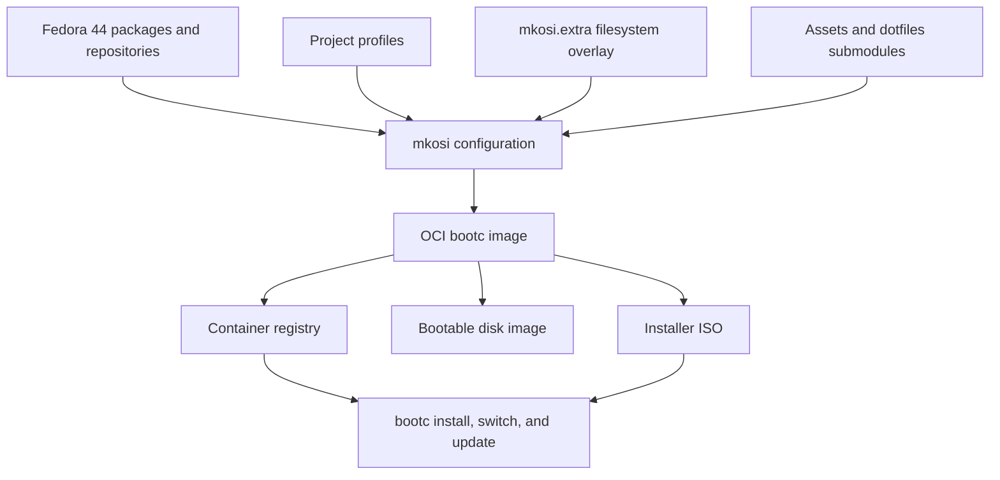

# Operating System Project Summary

> **Document status:** Living project overview  
> **Current upstream identity:** Zirconium  
> **Base:** Fedora 44  
> **Last reviewed:** 2026-10-18

## 1. Project overview

This repository builds a complete, opinionated Linux desktop operating system image. It does **not** implement a new kernel or an operating system from scratch. Instead, it assembles Fedora, the Linux kernel, systemd, a Wayland desktop, applications, configuration, installation media, and an image-based update system into a custom distribution.

The current project is Zirconium, an existing Fedora-based distribution focused on:

- An image-based, reliable operating system built with `mkosi`.
- Transactional deployment and updates through `bootc` and OSTree.
- The Niri scrolling Wayland compositor.
- DankMaterialShell as the desktop shell.
- Container-oriented development with Podman and Distrobox.
- A usable desktop out of the box.
- Standard and NVIDIA-specific images.
- AMD64 (`x86_64`) and ARM64 (`aarch64`) builds.

If this repository will become a separate operating system, the current Zirconium name, artwork, registries, signing keys, package selection, defaults, documentation, and support links must eventually be replaced with the new project's identity.

## 2. Product definition

### Intended result

The normal build produces an OCI container image marked as a `bootc` operating system image. That image can be:

1. Published to a container registry.
2. installed or switched to from a compatible Fedora Atomic/bootc system;
3. converted into a bootable disk image; or
4. used to generate an installer ISO.

### Current user experience

The installed system currently provides:

- Niri as the Wayland compositor.
- DankMaterialShell as the shell and desktop interface.
- `greetd` for graphical login.
- Foot as the preferred terminal.
- Nautilus for graphical file management.
- PipeWire and WirePlumber for audio and media routing.
- NetworkManager for wired, wireless, VPN, and mobile networking.
- Flatpak with Flathub integration.
- Podman and Distrobox for container workloads.
- Fcitx 5 and related input methods.
- Accessibility, printing, camera, mobile device, smart-card, and YubiKey support.
- Optional NVIDIA drivers and container integration through the `nvidia` profile.

### Non-goals of the current repository

- Writing a custom kernel.
- Replacing Fedora's package manager or repositories entirely.
- Implementing a new bootloader.
- Keeping every application mutable in the host operating system.
- Storing generated images, caches, or complete source listings in documentation.

## 3. High-level architecture



### Core technologies

| Component | Responsibility |
| --- | --- |
| Fedora 44 | Base distribution, kernel, firmware, RPM packages, and security policy |
| `mkosi` | Composes packages, profiles, overlays, and scripts into OS artifacts |
| `bootc` | Installs and updates the operating system from OCI images |
| OSTree | Supports image-based, transactional deployments |
| systemd | Init, service management, presets, temporary files, users, and boot integration |
| Podman | Builds, loads, validates, and publishes container images |
| Niri | Scrolling Wayland compositor |
| DankMaterialShell | Desktop shell and user interface |
| `greetd` | Login manager |
| Flatpak | Primary mechanism for many graphical applications |
| GitHub Actions | Multi-architecture builds, image publication, and ISO generation |

## 4. Build composition

The primary `bootc` build combines these profiles:

```text
base + base-desktop + bootc-ostree + brew + zirconium-bootc-ostree
```

Optional profiles such as `nvidia` or `jackrabbit` are appended for specialized variants.

### Profile responsibilities

| Profile | Purpose |
| --- | --- |
| `base` | Kernel, firmware, core Fedora packages, SELinux, networking foundations, Podman, and system tools |
| `base-desktop` | Audio, printing, cameras, desktop networking, virtualization guests, storage, and desktop hardware support |
| `bootc-ostree` | Produces the OCI bootc/OSTree image and removes content inappropriate for the immutable image |
| `brew` | Adds Homebrew prerequisites and integration |
| `zirconium-bootc-ostree` | Final cleanup and distribution-specific bootc behavior |
| `nvidia` | NVIDIA driver repositories, packages, kernel arguments, and related services |
| `jackrabbit` | Gaming-oriented additions and configuration |
| `liveiso-bootc-ostree` | Live environment and installer support |
| `sysupdate` | Experimental systemd-sysupdate/particleOS-style disk image path; not the default |

### Filesystem overlay

[`mkosi.extra/`](mkosi.extra/) mirrors paths that are copied into the final operating system. It contains:

- Command-line tools such as `zjust`, `zfetch`, `zmotd`, `zocr`, and TPM2 unlock helpers.
- systemd system and user units.
- system and user presets.
- `tmpfiles.d` and `sysusers.d` declarations.
- `greetd`, shell, terminal, input-method, and desktop configuration.
- Flatpak preinstallation configuration.
- Distribution text, shell helpers, and Fastfetch configuration.

Profile-specific `mkosi.extra/` directories add files only when their corresponding profile is enabled.

### Build hooks

- [`mkosi.prepare.chroot`](mkosi.prepare.chroot) downloads reusable build inputs, currently the Flathub remote definition.
- [`mkosi.postinst.chroot`](mkosi.postinst.chroot) performs final image setup, validates expected files, generates command completions, updates the font cache, adjusts PAM, and writes Zirconium's `os-release` identity.
- Profile-specific hooks install or configure behavior for bootc, NVIDIA, sysupdate, live ISO, Homebrew, and Jackrabbit variants.

## 5. Repository map

| Path | Description |
| --- | --- |
| [`README.md`](README.md) | Short, user-facing introduction and installation instructions |
| [`PROJECT_SUMMARY.md`](PROJECT_SUMMARY.md) | Architecture, development plan, and project-wide documentation |
| [`mkosi.conf`](mkosi.conf) | Top-level distribution, release, validation, output, and cache settings |
| [`mkosi.conf.d/`](mkosi.conf.d/) | Fedora and Zirconium package/repository composition |
| [`mkosi.profiles/`](mkosi.profiles/) | Reusable feature and output profiles |
| [`mkosi.extra/`](mkosi.extra/) | Files copied directly into the operating system |
| [`mkosi.sandbox/`](mkosi.sandbox/) | Repository and DNF configuration available to the build sandbox |
| [`Justfile`](Justfile) | Local build, test, image, and cleanup commands |
| [`iso.toml`](iso.toml) | Standard installer customization |
| [`iso-nvidia.toml`](iso-nvidia.toml) | NVIDIA installer customization |
| [`.github/workflows/`](.github/workflows/) | CI builds, publication, multi-architecture manifests, and ISO generation |
| [`assets/`](assets/) | Branding and ISO assets, included as a Git submodule |
| `mkosi.extra/usr/share/zirconium/zdots/` | Managed desktop dotfiles, included as a Git submodule |
| [`cosign.pub`](cosign.pub) | Public key used by the container trust configuration |
| [`LICENSE`](LICENSE) | Repository license |

## 6. Images and release variants

| Variant | Architectures | Description |
| --- | --- | --- |
| Standard | AMD64, ARM64 | Default desktop image for AMD/Intel graphics and general hardware |
| NVIDIA | AMD64, ARM64 | Standard image plus the `nvidia` profile |
| Rawhide | AMD64, ARM64 | Development image based on Fedora Rawhide |
| Jackrabbit | AMD64 | Gaming-oriented image using the `jackrabbit` profile |
| Sysupdate/DDI | AMD64, ARM64 in CI | Experimental systemd-sysupdate artifact set |

The standard and NVIDIA images are published as multi-architecture manifests. CI also creates dated, release-numbered, commit-specific, pull-request, and default tags.

## 7. Local development workflow

### Important tools

The build process uses:

- `git` with submodule support;
- `mkosi` version 26 development series or newer, as required by `mkosi.conf`;
- `just`;
- Podman;
- `qemu-img` and `vmbuddy` for the optional VM iteration flow;
- sufficient disk space for package caches, OCI layers, and disk images;
- a Linux host capable of privileged image-building operations.

Clone with submodules, or initialize them after cloning:

```bash
git submodule update --init --recursive
```

Inspect the fully merged configuration before building:

```bash
mkosi cat-config --debug
```

### Common commands

Build the standard bootc image:

```bash
just build
```

Load the resulting image into Podman, validate it, and optimize its layers:

```bash
sudo just load
sudo just lint
sudo just rechunk
```

Run the complete bootc disk-image iteration flow:

```bash
just iterate-bootc
```

Build the experimental sysupdate image:

```bash
just build-sysupdate
```

Remove generated build output and caches:

```bash
just clean
```

Generated output belongs in `mkosi.output/`; it should not be committed.

## 8. Installation and update model

### Registry installation or rebase

The current standard image can be selected from a compatible bootc/Fedora Atomic system with:

```bash
sudo bootc switch ghcr.io/zirconium-dev/zirconium:latest
```

The NVIDIA image uses:

```bash
sudo bootc switch ghcr.io/zirconium-dev/zirconium-nvidia:latest
```

These registry paths must be changed when publishing an independent distribution.

### Installer media

The ISO workflow:

1. pulls the published bootc image;
2. runs `bootc-image-builder` to produce an Anaconda-based ISO;
3. applies installer branding from `assets/iso`;
4. creates a SHA-256 checksum; and
5. uploads release artifacts to configured S3-compatible storage.

[`iso.toml`](iso.toml) and [`iso-nvidia.toml`](iso-nvidia.toml) make the installed system switch to the matching registry image after installation.

### Updates and rollback

The default product follows bootc's image-based update model. System state is derived from a published OCI image rather than a sequence of untracked package changes. Updates create a new deployment, while the previous deployment can be retained for rollback. User data and intended persistent state remain separate from the read-only image content.

## 9. Automation and publication

GitHub Actions currently performs the following work:

- Builds AMD64 and ARM64 images on architecture-matched runners.
- Initializes Git submodules.
- builds with `mkosi`;
- loads and lints bootc images;
- rechunks OCI layers for efficient updates;
- signs image pushes with a Sigstore private key;
- publishes per-architecture images and a unified manifest to GHCR;
- builds standard, NVIDIA, Rawhide, and Jackrabbit variants;
- builds experimental DDI/sysupdate artifacts with ORAS; and
- creates standard and NVIDIA installer ISOs on a schedule or manual request.

Publication requires repository secrets for image signing and, for ISOs, S3-compatible storage credentials.

## 10. Configuration and customization model

### System-owned configuration

Files under `/usr` come from the image and are replaced by operating-system updates. Project defaults should therefore be added through `mkosi.extra/`, profiles, package configuration, systemd presets, or build hooks—not edited manually on an installed machine.

Factory defaults placed under `/usr/share/factory/etc` are materialized into `/etc` through systemd-tmpfiles rules. This supports sensible defaults while keeping the image composition reproducible.

### User customization

Niri customizations should be kept in:

- `~/.config/niri/local.kdl` for one user; or
- `/etc/niri/local.kdl` for all users.

The project-managed base dotfiles can change during OS updates, so user changes should be placed in documented local override files rather than editing generated defaults.

### Applications

Use the appropriate delivery mechanism:

- **Image packages:** core drivers, system services, shells, and software needed before login.
- **Flatpak:** desktop applications that benefit from sandboxing and independent updates.
- **Distrobox/Podman:** development toolchains and mutable command-line environments.
- **Homebrew:** supported user-space command-line packages where appropriate.

This separation keeps the host image stable and limits unnecessary image rebuilds.

## 11. Security model and current limitations

Current security-related behavior includes:

- SELinux packages and container policy.
- Container image trust policy and a bundled public key.
- Sigstore signing in the publication workflow.
- TPM2/LUKS support files.
- PAM integration for `greetd`, GNOME Keyring, U2F, and YubiKey use cases.
- Transactional image updates and bootc validation.

Known limitations or items requiring a project decision:

1. `SecureBoot=no` and `SignExpectedPcr=no` are set in the top-level configuration.
2. The NVIDIA kernel module is currently not signed, so the NVIDIA image does not support Secure Boot as documented in the README.
3. The sysupdate profile explicitly uses test-only key generation in CI and is not production-ready.
4. Production image signing keys must never be committed to this repository.
5. The bundled trust key, registry policy, owner names, and update URLs must be replaced before independent publication.
6. [`LICENSE`](LICENSE) states GNU AGPL version 3 or later, while workflow metadata currently declares `AGPL-2.0`; that metadata should be corrected after confirming the intended SPDX identifier.

## 12. Turning this into a separate operating system

Use this checklist to avoid shipping a partially renamed fork.

### Identity and governance

- [ ] Choose the distribution name, purpose, target users, and support policy.
- [ ] Verify that the name and logo are available for use.
- [ ] Replace Zirconium names, slogans, artwork, colors, URLs, and package labels.
- [ ] Define maintainers, contribution rules, release cadence, and issue tracking.
- [ ] Preserve upstream copyright and license notices where required.

### Technical identity

- [ ] Update `ImageId`, hostname, `os-release`, issue text, and default hostnames.
- [ ] Rename image names and all GHCR references.
- [ ] Replace ISO volume labels and installer branding.
- [ ] Fork or replace the `assets` and `zdots` submodules.
- [ ] Review every file under `mkosi.extra/` for inherited branding and behavior.
- [ ] Review package sources and third-party repositories for trust and redistribution terms.

### Security and release infrastructure

- [ ] Generate and protect new image-signing keys.
- [ ] Replace `cosign.pub` and registry trust policies.
- [ ] Configure GitHub environments and publication secrets.
- [ ] Decide whether Secure Boot will be supported.
- [ ] Establish an update, rollback, vulnerability-response, and key-rotation policy.
- [ ] Configure storage and a download domain for ISOs and checksums.

### Product decisions

- [ ] Review the base package set and remove software that does not fit the new product.
- [ ] Decide which architectures and GPU variants are officially supported.
- [ ] Decide whether Jackrabbit and experimental sysupdate builds remain in scope.
- [ ] Define first-boot, account creation, recovery, and factory-reset behavior.
- [ ] Test bare metal, virtual machines, installation, updates, rollback, and data persistence.

### Documentation

- [ ] Replace the current README with the new product's concise user guide.
- [ ] Add contributor setup, release, security, and recovery documentation.
- [ ] Record architectural decisions in `docs/decisions/` as the project evolves.
- [ ] Keep this summary synchronized with major architecture changes.

## 13. Proposed roadmap

### Phase 1 — Define

1. Choose the product identity and target audience.
2. Decide what will differ from Zirconium.
3. Audit inherited code, assets, repositories, and licenses.
4. Select supported hardware and release channels.

### Phase 2 — Rebrand and simplify

1. Replace identity and registry references.
2. Remove unwanted profiles, packages, services, and novelty scripts.
3. Fork or replace both Git submodules.
4. Establish clean standard and NVIDIA builds.

### Phase 3 — Secure the supply chain

1. Create signing keys and trust policy.
2. Pin and review third-party repositories and CI actions.
3. Add automated image validation and vulnerability checks.
4. Resolve Secure Boot and NVIDIA signing policy.

### Phase 4 — Test installation and updates

1. Boot images in a VM on every pull request.
2. Test installation from ISO on AMD64 and ARM64 where supported.
3. Test upgrades, rollback, rebase, encryption, and recovery.
4. Add a release-candidate channel before publishing stable releases.

### Phase 5 — Release and maintain

1. Publish signed images, manifests, ISOs, and checksums.
2. Publish support and security policies.
3. Monitor upstream Fedora, bootc, mkosi, Niri, and shell changes.
4. Maintain reproducible release notes and a tested rollback path.

## 14. Documentation policy: should all code be in Markdown?

**No.** Keeping all source code inside this document would duplicate the repository, make reviews difficult, and cause the documentation to become outdated whenever a source file changes.

Use Markdown for:

- goals and non-goals;
- architecture and design decisions;
- directory and component explanations;
- setup, build, test, release, and recovery procedures;
- short commands and small examples; and
- links to the source files that implement a feature.

Keep implementation in its native files:

- shell logic in executable scripts;
- image settings in `mkosi.conf` files;
- services in systemd unit files;
- CI logic in workflow YAML;
- installer settings in TOML; and
- desktop settings in their native configuration formats.

Include a code block in documentation only when it is a command the reader should run, a minimal example, or an interface contract. For exact implementation details, link to the source file so there is one source of truth.

## 15. Definition of success

The project can be considered ready for an initial release when:

- branding and ownership are unambiguous;
- all supported images build reproducibly in CI;
- images and installation media are signed and published from project-controlled infrastructure;
- clean installation, first boot, updates, rollback, and recovery have been tested;
- standard desktop hardware works for the declared support matrix;
- licenses and third-party repository policies have been reviewed;
- user, contributor, release, and security documentation exists; and
- maintainers can respond to failed updates or compromised signing infrastructure.

---

This document describes the repository at a point in time. Configuration files and executable source remain authoritative when this summary and the implementation differ.
